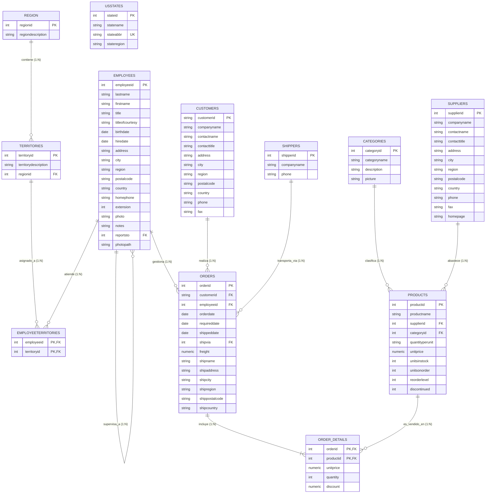

# Arquitectura y Modelo de Datos Relacional: Northwind

Este documento detalla la ingeniería inversa, auditoría de entidades, modelo conceptual/lógico, diagrama entidad-relación en Mermaid con cardinalidades estrictas, esquema físico y justificaciones de diseño a partir del archivo fuente `northwind.xlsx`.

---

## 1. Auditoría del Origen de Datos (`northwind.xlsx`)

Se inspeccionaron minuciosamente las 13 hojas del libro Excel, auditando columnas, tipos de datos, cardinalidades, claves primarias y foráneas.

| Hoja en Excel | Filas | Columnas | Clave Primaria (PK) | Dependencias Foráneas (FK) | Rol en el Negocio |
| :--- | :---: | :---: | :--- | :--- | :--- |
| `region` | 4 | 2 | `regionid` | Ninguna | Catálogo geográfico macro |
| `territories` | 53 | 3 | `territoryid` | `regionid -> region(regionid)` | Territorios comerciales |
| `categories` | 8 | 4 | `categoryid` | Ninguna | Clasificación de productos |
| `suppliers` | 29 | 12 | `supplierid` | Ninguna | Proveedores de mercancía |
| `customers` | 91 | 11 | `customerid` | Ninguna | Cartera de clientes |
| `employees` | 9 | 18 | `employeeid` | `reportsto -> employees(employeeid)` | Fuerza laboral y jerarquía |
| `employeeterritories` | 49 | 2 | `(employeeid, territoryid)` | `employeeid`, `territoryid` | Asignación comercial N:M |
| `shippers` | 6 | 3 | `shipperid` | Ninguna | Empresas transportistas |
| `shippers_tmp` | 6 | 3 | `ShipperID` | Ninguna | **Tabla de Staging idéntica a shippers** |
| `usstates` | 51 | 4 | `stateid` | Ninguna | Catálogo federal de estados USA |
| `products` | 77 | 10 | `productid` | `supplierid`, `categoryid` | Catálogo de artículos vendibles |
| `orders` | 830 | 14 | `orderid` | `customerid`, `employeeid`, `shipvia -> shippers` | Encabezados de venta y flete |
| `order_details` | 2,155 | 5 | `(orderid, productid)` | `orderid -> orders`, `productid -> products` | Líneas de pedido (Venta neta) |

### Justificación de `shippers_tmp` y `usstates`
1. **`shippers_tmp`**: Tras la comparación por hash y contenido registro a registro, se demostró que `shippers_tmp` es una réplica exacta de `shippers` (tabla de staging temporal). Se preserva en el análisis documental y se excluye del esquema relacional productivo para evitar anomalías de redundancia y actualización.
2. **`usstates`**: Catálogo de 51 estados de EE.UU. que sirve como tabla de referencia y normalización para los clientes y empleados ubicados en EE.UU.

---

## 2. Diagrama Entidad-Relación (Mermaid) con Cardinalidades

---

## 3. Esquema Físico y Restricciones de Integridad

- **Claves Primarias Compuestas**: `order_details` utiliza `(orderid, productid)` y `employeeterritories` utiliza `(employeeid, territoryid)`. Ambas fueron verificadas con cero duplicados.
- **Autorreferencia**: `employees.reportsto` referencia a `employees.employeeid`. El directivo Andrew Fuller (`employeeid=2`) tiene `reportsto = NULL` (nodo raíz de la jerarquía).
- **Validaciones CHECK**:
  - `order_details.quantity > 0`
  - `order_details.discount BETWEEN 0.0 AND 1.0`
  - `order_details.unitprice >= 0`
  - `products.discontinued IN (0, 1)`
  - `orders.freight >= 0`

---

## 4. Reconciliación Matemática y Cero Datos Simulados

| Parámetro | Valor Verificado en Excel | Valor en Base de Datos Relacional | Discrepancia |
| :--- | :---: | :---: | :---: |
| **Ventas Netas** | **$1,265,793.0395** | **$1,265,793.0395** | **$0.000000** |
| **Ventas Brutas** | $1,354,458.5900 | $1,354,458.5900 | $0.000000 |
| **Descuentos Comerciales** | $88,665.5505 | $88,665.5505 | $0.000000 |
| **Total de Fletes** | $64,942.6900 | $64,942.6900 | $0.000000 |
| **Unidades Totales** | 51,317 | 51,317 | 0 |
| **Líneas de Detalle** | 2,155 | 2,155 | 0 |
| **Órdenes de Compra** | 830 | 830 | 0 |
| **Clientes Totales** | 91 | 91 | 0 |
| **Clientes con Compras** | 89 | 89 | 0 |
| **Clientes sin Compras** | 2 (`FISSA`, `PARIS`) | 2 (`FISSA`, `PARIS`) | 0 |
